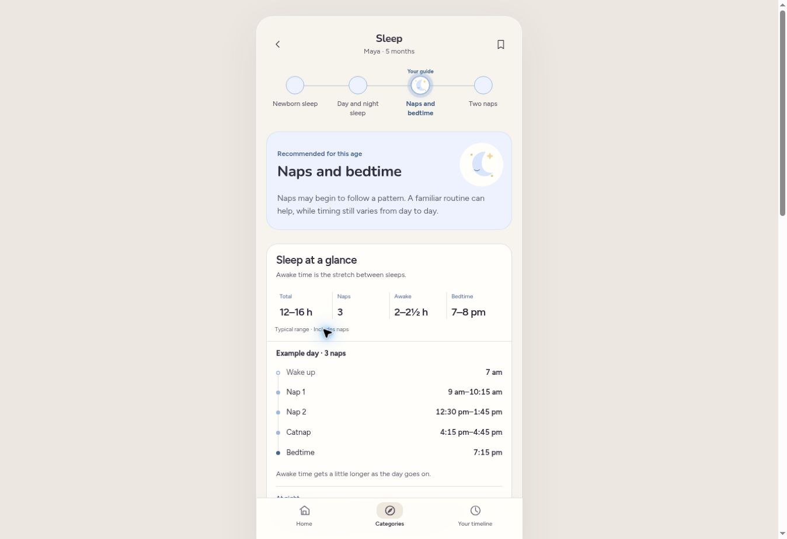

# First-year editorial acceptance

This is the consolidated editorial decision for the current review branch. It supersedes the initial `editorial-review-2026-10-23.md` wherever the implementation has moved on.

**Decision:** the reviewed first-year MVP is ready for a small beta on editorial grounds after this branch is merged and its checks pass. The pass found substantive weaknesses and implemented fixes; it did not accept the app merely because routes rendered successfully. No known editorial blocker from this pass is left as a suggestion to implement later.

This is an AI-assisted product/content review, not a pediatrician's endorsement or observation of real parents. Medical review and actual comprehension testing remain separate evidence.

## What was reviewed

The unit of review was the parent-facing experience: an introduction, recommendation, skill, activity, question/answer or reference and the route to it. A sentence was evaluated in context, not simply checked for length or duplicate wording.

The checks were:

1. What specific question would a first-time parent have here?
2. Does the answer let them understand, decide, prepare or do something?
3. Why is this useful now, and does that reason use a real age, report or upcoming decision?
4. What should happen next—and what should stop being promoted afterward?
5. Is the information already provided nearby or in another category?
6. Is the wording understandable without knowing parenting terminology?

Coverage includes newborn–12-month Home and category overviews; all 59 Development skills; all 78 default monthly Play slots; movement-dependent play; seven Health visit guides and their expectation, vaccine, question and help pages; all Sleep/Feeding stages, transient changes, FAQ answer branches, settling choices and references; and Safety's 17 stable checklist items and carry-forward behavior. Profile and completion state were checked where they change what a parent reads.

`editorial-acceptance-register.json` captures 361 inventory entries, including repeated monthly views and individual answer branches. **That is an inventory count, not 361 independent expert approvals.** The register stores actual text/source content, route, timing context and hashes so later changes can be identified. It includes the four milk-reference variants. The judgment and reasons are in this report.

## Decisions by category

| Area | Parent's question | What needed fixing | Implemented result |
| --- | --- | --- | --- |
| Home, first weeks | What should I know first? | Safe sleep could be absent while less important rows took the available slots. | One compact route to the existing safe-sleep checklist in the first six weeks. Milk feeding and the first checkup remain prominent. Completed setup disappears; it does not become a permanent warning. |
| Home, 3 months | What could change soon? | The summary mentioned a sleep change without reliably offering preparation. | A timely route to the 4-month sleep-change guide when Sleep is not already occupying a current slot. |
| Home, 4 months | Do I need to decide about sleep training? | Optional education existed but was easy to discover only once wanted urgently. | Preparation introduces optional methods around 4–6 months, without telling parents to start. Choosing another support approach removes this education prompt. |
| Home, 7–8 months | How would I know the catnap is ready to go? | Age-stage navigation alone made the transition easy to overlook. | A preparation link explaining the pattern to look for; it retires after a two-nap report or an explicit choice to stay with three. |
| Home throughout | Why am I seeing this? | Recommendations could imply reported abilities or promote the same topic twice. | Preserve the existing reason labels, three-current/two-preparation caps and one-category rule. Saved movement stays distinct from age-based preparation. |
| Sleep snapshot | What might a day actually look like? | The page showed awake intervals but no clock-time sample day. | Restore a compact example using durations inside the same guide's ranges. Three displayed naps means three example naps; two means two. Early weeks retain a flexible feed/awake/sleep loop. |
| Sleep routines | What can I do before sleep? | Two tips repeated the short-nap adjustment; familiar routines were mentioned more than explained. | Give a concrete two- or three-step wind-down alongside tired-cue guidance. Keep night feeding separate from settling. |
| Sleep approach | What if I'm already trying, doing well or helping baby to sleep? | The main entry still described comparing methods regardless of selected support. | The entry's title and benefit change with the existing choice: learning, trying, maintaining a routine or settling with help. The five-method illustrated carousel stays. |
| Sleep exploration | Is this older guide appropriate for my newborn? | A generic “use this guide” button could assign an older age's pattern. | Future guides remain readable. Only age-appropriate nap-pattern reports offer an update. Older saved overrides and legacy actions are guarded too. |
| Sleep disruption | Is this definitely a regression or separation anxiety? | Some answers diagnosed the cause from one choice, and others promised a fixed recovery time. | Give observations and useful responses without diagnosing. Keep conditional language around regressions; no guaranteed rough patch or finish date. |
| Sleep change pages | Why am I reading an empty schedule card? | Temporary-change pages reused the main-page card even without numbers or a schedule. | Remove those empty cards. Keep recognition, explanation, useful actions and one specific practical note. |
| Feeding, newborn | What does feeding on demand actually mean? | Hunger cues were listed without a concrete meaning for the day. | Explain offering milk at cues even if the previous feed was an hour ago. Scheduled feeding plans and growth checks still take priority. |
| Feeding, milk references | Are these amounts for the milk I'm giving? | “Bottles” inherited formula-style amounts for expressed breast milk. | Separate Nursing, Breast-milk bottles, Formula bottles and Nursing and bottles in the existing selector. The expressed-milk reference uses its source's 1–6-month age range; no formula ceiling is applied to it. Early-birth guidance identifies the pediatrician's milk/supplement plan as the appropriate individual plan. |
| Feeding, common milk questions | Where can I find spit-up help after the newborn guide? | The question was easy to lose after progressing to the next stage. | Reuse the canonical spit-up answer in the milk reference, reachable throughout the year. No duplicated new monthly lesson. |
| Preparing for solids | How do I choose purées, baby-led weaning or both? | Definitions were behind preference buttons that asked parents to choose before they could compare. | One expandable question now reveals three short, labeled explanations together, with practical differences and the option to combine. No extra page or choice is required to learn. |
| Preparing for solids | Does extra hunger mean readiness? | Growth-spurt explanations were too certain; watching at the table did not add enough. | Hunger alone is not readiness. Keep recognizable readiness signs and remove the weak “bring baby to the table” item. |
| First foods | What could I offer, and how? | “Make a food manageable” left the parent to supply the missing example. | Give a few iron-rich examples and concrete spoon/self-feeding options. Preserve small starting portions, allergens and fullness cues without a long prescribed menu. |
| Feeding progression | How do we move on without cutting milk too soon? | One answer told parents to offer food before milk and implied milk was the explanation for poor eating. | Keep milk alongside food, distinguish changing appetite from persistent difficulty, and request an individual review before reducing milk. Repeated texture problems have a clear next step. |
| Family meals | What makes a simple meal? | “Offer what you eat, prepared safely” lacked the promised practical help. | A small portion with an iron-rich food, soft produce and a starchy food, adapted for baby's skills; set it aside before adding salt. |
| Turning one | What changes in milk and cups? | A generic milk quantity could be read as formula advice before one, or a reason to end breastfeeding. | Name the cow's-milk reference where it applies, label the formula-to-milk transition and preserve continued breastfeeding. Late starters retain their eating-experience guide and individual-review connection. |
| Feeding stage actions | Am I learning or reporting that something happened? | “Update to this stage” was too abstract, especially when browsing an earlier guide. | Buttons name the report: not started solids, started solids, managing textures or regular meals. Milk reference pages do not offer a way to report that solids stopped. |
| Safety | What does new movement change at home? | Preparation names could sound like confirmed skills. | Preserve the clearer preparation rail, concrete single-owner checklists, detailed installation/storage help, saved progress and Doesn't apply. No invented crawling or pulling-up report and no duplicate checklist to complete. |
| Health | What's specific to this checkup? | Navigation descriptions were identical at every visit. | Visit-specific previews identify newborn results, early responses, first foods, the 9-month questionnaire or first-birthday checks. The 9-month vaccine link explicitly says catch-up doses and seasonal protection. |
| Health between visits | Is there something new I must do every month? | Filling the gaps risks manufactured care tasks. | Keep the next actual visit guide as a reference. Home promotes its preparation only when timely. Retain appointment notes separately from questions and explicit attendance recording. |
| Development | What does the skill look like, and how can I help? | Most existing individual examples were already specific enough; broad rewrites would add churn. | Keep the consistent example, support action, CDC illustration/video and optional saved moment. Improve the pulling-up support with a concrete lowering practice rather than merely saying to provide space. |
| Development timing | Should my younger baby do all of this now? | Monthly changes could be mistaken for new milestone deadlines. | Keep canonical CDC reference-age groups and the earlier-month footnote. Home's monthly summary describes emerging changes; it does not create a fresh deadline for each month. |
| Play | Is this a new idea or an old activity with a new name? | Different IDs still concealed two very similar games. | Replace the month-three echo variation with a talking puppet/toy game and a later container variation with supported water pouring. Preserve old links and safe, easier adaptations. |
| Play detail | Why does this support development? | Two consecutive purpose sentences repeated the same benefit. | Keep one fuller skill connection, followed by setup, actual steps, what to notice and adaptations. No forced completion or performance target. |
| FAQ formatting | Does the second paragraph add anything? | The template encouraged a “Good to know” sentence even when it repeated the answer. | Allow the extra context to be absent. A text reference promising a food-preparation guide now has an actual link. |
| Saved information | Will the guidance move on after I answer? | The 28-day interval mixed a precise answer time with an artificial local-noon date stamp. | Prefer the actual timestamp for that same day, while preserving date-only fallback for direct stage updates. Verify the boundary in UTC, Los Angeles and São Paulo. |

## Repetition retained deliberately

These are the places where repeat availability earns its place:

- **A real check happens again:** growth measurements and certain vaccine doses belong to more than one checkup. Visit-specific expectations, dose windows and eligibility explain the difference.
- **The same guide spans a range:** Development's CDC groups and Sleep/Feeding stages stay recognizable. They are not relabeled as a different discovery every month. The baby's report, completion or meaningful transition changes the recommendation.
- **A reference may be needed again:** milk handling, spit-up, allergens, food preparation and help boundaries remain available. Opening a guide never counts as learning or completing it.
- **An unresolved action remains relevant:** unfinished babyproofing is still available, but completion and Doesn't apply persist. A later rail stop does not create another copy of the same checklist.
- **A familiar skill has a genuinely different game:** putting a toy in, transferring between places and pretending to use an object can recur through different activities. Simple word/ID changes are not sufficient evidence; this pass specifically replaced two weak semantic variations.

## Parent tasks checked

| Starting situation | What the parent should leave understanding |
| --- | --- |
| Newborn, no parenting knowledge | How feeding cues affect the next feed; where to check safe sleep; what the first checkup reviews. |
| Three months, swaddle already stopped | The upcoming sleep change can happen, what it may look like and where to learn how to respond. No premature training methods. |
| Four months, undecided on sleep training | Education is optional; learning is not starting. Choosing settling with help does not keep promoting training. |
| Five months, not started solids | Preparation and readiness are distinct from giving food; the three feeding approaches can be compared before choosing. |
| Five months, expressed breast-milk bottles | The selected milk reference describes expressed milk, not formula assumptions. Food remains a separate reported experience. |
| First tastes at six months or later | Recognizable first-food examples, a small start, hunger/fullness cues and allergen preparation; a visible progression question later. |
| Seven/eight months, naps changing | What repeated catnap difficulty might mean, without treating one skipped nap as proof. The example day matches the selected nap count. |
| Nine months, old roll saved and no later answers | Proactive mobile/higher-reach safety work, no invented skill, and a visible food-experience follow-up. |
| Nine-month checkup | A development questionnaire, feeding/growth discussion and vaccine-record review—not a guaranteed new vaccine series. |
| Twelve months, regular meals versus a late starter | Milk/cup transition guidance for the first family; experience-appropriate eating support and a review connection for the second. No automatic leap to family meals. |
| Early birth | Developmental references use adjusted age; Health follows birthday age. General milk references do not replace an individual feeding/supplement plan. |
| Returning parent with completed checks | Useful references and new preparation, without treating reading as completion or asking for the same safety work twice. |

## Verification and maintainability

- `node tools/qa/check-all.cjs` checks syntax/assets and all six suites: chronological journeys, pronouns, route/readiness checks, recommendation contracts, saved-once progression and editorial regression contracts.
- The editorial suite now protects the newborn Home setup, preparation timing, respecting a chosen sleep approach, browsing versus reporting, example-day/nap-count agreement, the distinct milk references, legacy activity routes and continued access to spit-up help. It does not pretend to measure usefulness.
- The saved-once suite was also run with `TZ=UTC`, `TZ=America/Los_Angeles` and `TZ=America/Sao_Paulo` after the timing fix.
- `node tools/qa/content-review-register.cjs --write` regenerates the exact content inventory. Review changed entries and their visible context; do not treat regeneration as editorial acceptance.
- External sources are checked with `python3 tools/qa/link-check.py`. The final run reached all 130 URLs, including the previously intermittent childproofer directory.
- All six automated suites passed: 100 chronological family journeys, 100 saved-once progression journeys, 312 recommendation states and 422 editorial regression assertions, alongside route/readiness and pronoun checks. Counts describe coverage, not independent approval of each sentence.
- Actual Chrome checks used fictional newborn, three-, five-, eight- and twelve-month profiles: first-weeks Home priorities; advance sleep preparation; the three-nap clock-time sample; expressed-milk selection; the purées/BLW comparison; spit-up answer interaction; nine-month Health expectations; and the new puppet and water-play details. The fixture is excluded from the app and PR. Screenshots retain the existing visual identity.

### Source checks for substantive wording

New wording was checked against primary guidance rather than commercial course copy:

- [AAP: starting foods](https://www.healthychildren.org/English/ages-stages/baby/feeding-nutrition/Pages/Starting-Solid-Foods.aspx)
- [AAP: baby-led weaning and purées](https://www.healthychildren.org/English/ages-stages/baby/feeding-nutrition/Pages/baby-led-weaning-is-it-safe.aspx)
- [HSE: expressed-milk amounts](https://www2.hse.ie/babies-children/breastfeeding/expressing-pumping/how-much-breast-milk-express/)
- [AAP: formula amounts](https://www.healthychildren.org/English/ages-stages/baby/formula-feeding/Pages/Amount-and-Schedule-of-Formula-Feedings.aspx)
- [AAP: reflux](https://www.healthychildren.org/English/health-issues/conditions/abdominal/Pages/GERD-Reflux.aspx)
- [CDC: food textures and introduction](https://www.cdc.gov/infant-toddler-nutrition/foods-and-drinks/when-what-and-how-to-introduce-solid-foods.html)
- [AAP: a sample meal pattern at 8–12 months](https://www.healthychildren.org/English/ages-stages/baby/feeding-nutrition/Pages/Sample-One-Day-Menu-for-an-8-to-12-Month-Old.aspx)
- [CDC: foods/drinks to avoid or limit](https://www.cdc.gov/infant-toddler-nutrition/foods-and-drinks/foods-and-drinks-to-avoid-or-limit.html)
- [AAP: play with everyday objects](https://www.healthychildren.org/English/family-life/power-of-play/Pages/simple-ways-to-entertain-and-boost-your-babys-development-at-home.aspx)

### Remaining boundaries

There is no intentionally deferred copy fix from this pass. What remains unproven is clinical endorsement of the complete guidance, how real first-time parents interpret it, and whether their real situations reveal questions the reviewed paths did not surface. In particular, sleep-number ranges and milk references are educational starting points, not an individual prescription; early birth, growth/feeding difficulties and vaccine eligibility require individual review. A link's availability today is not a promise that its publisher will keep it available.

That is different from leaving known vague cards, empty guides or repetitive filler for beta testers to discover. Those issues were addressed where this pass found them.

