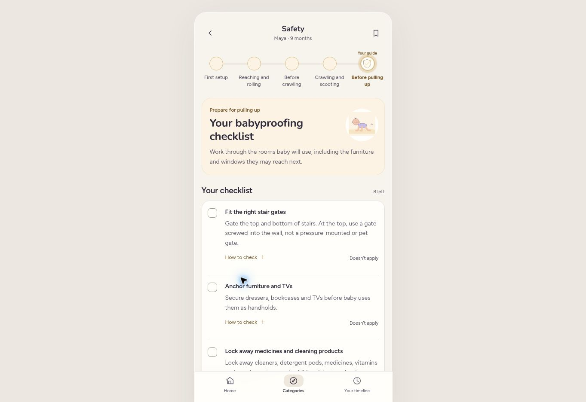

# Editorial review: earned content and recognizable stages

This pass reviews the app as a first encounter and a return visit. It preserves the existing page structure, illustrations, colors, timelines and completion records. It is an editorial review, not a pediatrician's approval or a claim that scripted families are real users.

## Acceptance standard

A promoted item must answer a specific parent question, provide useful understanding or a concrete next step, and have a reason to appear now. Preparation, a reported ability and a parent's choice are different. A guide can remain available as a reference without being introduced again as a new development. Reading never means learning, doing or completing.

For each section, ask: what question does this answer, what can the parent do with it, why now, when should it stop being promoted, and does another section already do the job? Prefer an existing reference or cross-link over a second lesson. Do not add content simply to fill a month.

## Scope actually read

- Home's 13 chronological summaries, plus the shared recommendation selection and reasons.
- Development's 59 skill details: recognizable examples, individual support actions and links to play. The CDC reference ages remain visible as reference ages, not assumed start dates.
- Play's 78 default monthly slots: instructions, skill connection, easier version and extension. Reviewed all activity bodies, not only titles. Movement-specific additions remain conditional on reported movement.
- Sleep's four main guides, both transient-change guides, all FAQ branches, safe-sleep and help references, and all four settling choices and five methods.
- Feeding's six guides, three transient-change guides, all FAQ branches, milk, first-aid, allergen and help references. Checked late starters as well as age defaults.
- Health's seven visit guides and 28 detail routes: expectations, vaccines, questions and help. A help page uses the baby's actual age even when reached from a different visit.
- Safety's five rail positions, three checklist owners and 17 stable checks, including the expandable instructions and not-applicable/completion behavior.

The review did not reinterpret vaccine schedules, introduce new sleep-number ranges or create clinical deadlines. Existing documented clinical-review needs remain.

## Concrete decisions and changes

| Location | Editorial problem | Decision implemented |
| --- | --- | --- |
| All category timelines | “Current” can sound like an assessment of baby's ability | Use **Your guide** on the recommended stop. The viewed stop remains separately selected. |
| Sleep rail and Home row | “Naps find a rhythm” implies a routine has already emerged | **Naps and bedtime**; keep charts and the sample day. |
| Sleep early guide and Home row | “Days and nights sort out” implies a guaranteed change | **Day and night sleep**; introduction allows variable timing. |
| Feeding milk guide and Home row | “Feeds find a rhythm” promises an orderly pattern | **Changing milk feeds**; growth and intake matter more than a fixed schedule. |
| Current Sleep introduction | Recommendation basis was unclear | Say **Recommended for this age**, **Based on your nap pattern**, or **Your selected sleep guide**, as appropriate. |
| Current Feeding introduction | A late starter could read the typical age as a personal assessment | Eating guides say **Based on what you shared** and define first tastes, textures or regular meals. Early milk guides remain age recommendations. |
| Browsing Sleep and Feeding | “This is where baby is now” hides what a button changes | **Use this sleep guide** or **Update to this feeding stage**. Next-stage actions name the experience being reported. |
| Browsing Safety | The same button could turn preparation into a report that baby crawls or stands | Remove the ability-recording CTA from preparation previews. Keep **Back to your guide**. Baby's updates and saved skills still record movement. |
| Safety rail | Ability names don't explain preparation | **First setup / Reaching and rolling / Before crawling / Crawling and scooting / Before pulling up**. The crawling-preparation label belongs to the existing proactive mobile checklist, not the earlier rolling checks. |
| Sleep: naps and two naps | Introduction and “Why” repeat the same change before the useful chart | Remove the duplicate Why section from these two main pages. Preserve it for newborn body-clock explanations and transient changes. |
| Sleep: newborn cues | A precise timer sounds like a rule for every newborn | Give recognizable tired cues and explain the range as a starting point. |
| Sleep: overnight help | Assumes two available parents | Qualify with **If another adult can help**, including help around feeds. |
| Sleep: nap troubleshooting | Two time choices leave parents between the endpoints without an answer | Ask what baby is showing: alert/interested or tired/upset. Remove the fixed five-month instruction from a multi-age guide. |
| Sleep: catnap troubleshooting | Advises car/stroller naps despite the safe-sleep reference | Use usual settling help in a safe sleep space; earlier bedtime if the nap doesn't happen. |
| Sleep: contact naps | The “yes” branch omits the awake-adult condition | Include staying fully awake in that branch too. Remove the unsupported 15–20-minute transfer rule. |
| Sleep: rolling FAQ | Abbreviated advice drops the both-directions condition | Keep back placement and both-directions wording, consistent with the existing reference. |
| Sleep: unexplained waking | One answer diagnoses a 4-month regression, even at eight months | Check feeding, discomfort and recent changes; remove the automatic regression diagnosis/link. |
| Sleep: bedtime troubleshooting | A multi-age guide gives a fixed nine-month wake window | Refer to the age-relevant range above and tired cues. |
| Sleep: separation | Assumes the parent already has a two-nap pattern | Keep the usual nap pattern, whatever it is; no invented nap count. |
| Sleep: harder bedtime | One answer diagnoses separation anxiety | Give conditional reassurance and checks for feeding, discomfort and timing. |
| Sleep: early waking | Before 7/after 8 leaves a missing answer; a clock rule can obscure feeding needs | Add 7–8 pm. Keep early waking quiet while responding to hunger and discomfort. |
| Sleep: two-nap transition | One week is treated as proof of readiness | Look for repeated comfortable days without the catnap; allow a third nap after short naps. |
| Sleep: two naps and night feeds | Nap count sounds like evidence a night feed is unnecessary | State that a nap transition does not establish readiness to drop a feed. |
| Sleep: car-seat reference | “For awake time” incorrectly describes use during travel | Distinguish car travel from routine sleep; transfer at the destination. |
| Feeding: first tastes, textures, meals | Titles alone require a parent to diagnose the stage | Add a brief, recognizable description of the eating experience each guide fits. |
| Feeding: changing milk feeds | “Can't spoil a baby with milk” isn't useful responsive-feeding advice | Hunger cues, fullness cues and variation between days. |
| Feeding: distracted feeds | Assumes missed daytime milk will be made up later | Watch total intake, diapers and growth; don't rely on night compensation. |
| Feeding: teething | Promises catch-up and waits a day despite reduced intake | Watch milk intake/diapers and contact the pediatrician for reduced intake or illness; don't assume the cause. |
| Feeding: textures | Pincer grasp and smooth-purée deadline overstate a single progression | Practice manageable textures prepared for the grasp baby uses. |
| Feeding: repeated vomiting/refusal | Wait-a-week advice and “keep an eye” don't support a clear next step | Contact the pediatrician about persistent texture difficulties; ask about a feeding assessment. Align the help reference. |
| Feeding: toothless finger foods | Softness alone is presented as sufficient | Shape and size matter too; use the existing preparation guide. |
| Feeding: possible choking FAQ | “Try this” sounds optional | **Act now** for the choking branch, preserving the emergency action. |
| Play: activity detail introduction | Short purpose and longer purpose say the same thing consecutively | Keep the fuller skill explanation on detail pages; short purpose remains on the browsing card. |
| Play: month 1 | Newborn sway activity appears as a new monthly recommendation | Replace the slot with **Follow my face**, a small gaze-following invitation. |
| Play: month 3 | Month-1 sound-answer activity is reintroduced unchanged | Replace with **Echo a little coo**, explicitly echoing a vowel baby makes. Preserve links from skills. |
| Play: old routes | Replacing activities could strand links | Old month-1 sway/month-3 sound links open their replacement activity. |
| Home: month 1 | Generic instruction to get comfortable with feeds | Describe alertness, looking and how to leave room for a response. |
| Home: month 12 | Summary is only about the checkup despite its broader headline | Include gestures, words and object play alongside checkup planning. |

## Content kept, with a reason

| Content | Parent question and useful result | Timing / repetition decision |
| --- | --- | --- |
| Development skill examples | “Would I recognize this?” Distinguishes, for example, propping on hands from unsupported sitting, or babbling from naming a parent. | Keep canonical CDC-age groups; don't rename old skills as new monthly discoveries. |
| Development's individual support actions | “How can I help without testing or forcing?” A brief action, with a Play link when a relevant current activity exists. | Keep the uniform detail layout; no extra example blocks or generic encouragement. |
| Play instructions and adaptations | “What can we do in this awake window?” Setup, action, observable response and an easier option. | Six distinct default activities per month; movement variants need the reported ability. Familiar skills can recur through genuinely different games. |
| Health expectations | “What will they check and what might it tell us?” Specific examination, questionnaire or test and its purpose. | Repeat the actual growth exam where it really occurs; don't invent a new screening every month. Between visits, keep the next actual visit guide. |
| Health vaccines | “What might be due?” Named vaccines, dose windows, seasonal/individual eligibility. | Record-dependent repeats are warranted, with one shared schedule note; not every seasonal vaccine is guaranteed at a visit. |
| Health questions vs notes | “What should I ask?” vs “What did we decide?” These serve different moments. | Keep separate, existing navigation and icons. |
| Safety's 17 checks | “What changes in my space, and how?” Concrete equipment/installation/storage steps and instructions. | Keep stable checklist IDs, saved completions and Doesn't apply. Don't copy the checklist into the next stage. Preparation can advance without claiming movement. |
| Sleep numbers and sample day | “What might the day look like?” Awake ranges, nap count, bedtime and example timing. | Preserve existing age-based values and matched sample nap counts. No new normative ranges introduced in this copy pass. |
| Settling choices and method carousel | “What can I choose, and what if I'm already trying?” Methods and different support for each decision. | Preserve optionality, under-four-month guidance, five illustrated methods and useful routine-recovery support. |
| Milk, food preparation and allergen references | “Where can I check this again?” Practical details that may stay useful after the first introduction. | Keep one reference home; a parent opening it does not mean they learned or completed it. |
| Help references | “Should I wait for the next visit?” A clear boundary and contact/action. | Intentionally accessible from multiple guides; not promoted as a new monthly lesson. |

## Evidence and limits

`node tools/qa/check-all.cjs` includes the existing 100-family chronological and saved-once progression suites, plus the new `editorial-contracts.cjs`. The new checks distinguish preparation previews from reported skills, exercise FAQ branches that previously gave unsupported conclusions, check all 78 default monthly activities for repeated IDs and working detail routes, preserve old routes, and verify feeding selection explanations.

These checks protect concrete editorial decisions. They cannot certify that a parent finds every sentence useful. Real-parent observation and pediatric review remain separate evidence, rather than being implied by the scenario count.

Safe-sleep clarifications were checked against AAP primary guidance on October 23, 2026:

- https://www.healthychildren.org/English/ages-stages/baby/sleep/Pages/A-Parents-Guide-to-Safe-Sleep.aspx
- https://www.healthychildren.org/English/tips-tools/ask-the-pediatrician/Pages/Is-it-safe-for-my-baby-to-travel-in-a-car-seat-a-few-hours-at-a-time.aspx

Browser QA uses local sample profiles, not personal medical records. The preview fixture is excluded from the repository changes. Chrome verification covered the recommended and browsed Sleep guides, current Feeding definitions and follow-up, Safety preparation labels and checklist, and the new month-three Play detail. The current-guide marker stays on the recommendation while another stop is being browsed.

The URL check reached 125 of 126 external URLs. The childproofer directory returned HTTP 503 to that checker; the primary directory page was retrievable through the web service and still exposes the professional search. Retained the correct directory URL rather than replacing it based on one transient response. The raw link report records the unverified response.

